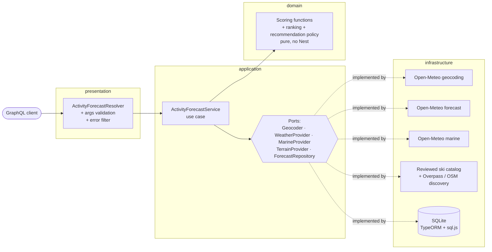

# Activity Forecast

GraphQL API (NestJS + TypeScript) that, for a city or town, recommends whether to
**plan**, **consider** or **skip** each activity over the next 7 days, backed by a
detailed day ranking for
**skiing**, **surfing**, **outdoor sightseeing** and **indoor sightseeing**.
Weather from [Open-Meteo](https://open-meteo.com) (forecast, marine, geocoding — no API
key), ski venues from a small reviewed catalog with OpenStreetMap (Overpass) discovery.
Confirmed ski venues use a separate mountain-coordinate/elevation forecast instead of
valley-town weather. Data is persisted in SQLite and refreshed lazily. No front end.

> Start with the [decision log](NOTES.md) and the honest
> [AI/work trail](ai-sessions/README.md) to see how the choices evolved.
> Interviewers who want the shortest clone-to-result path can use the
> [reviewer guide](docs/REVIEWER_GUIDE.md).

## Quickstart (60 seconds)

Needs Node.js 24+.

```bash
npm ci
npm run start:dev
# open http://localhost:3000/graphql (GraphiQL in local development)
```

No `.env` needed; the SQLite file is created at `data/activity-forecast.sqlite`.
All settings are optional and documented in [.env.example](.env.example).

Or with Docker:

```bash
docker compose up --build
# POST http://localhost:3000/graphql (the production image disables GraphiQL)
```

From the command line (needs the server running):

```bash
examples/query.sh                       # catalog-backed Chamonix recommendations
examples/query.sh recommendations.graphql  # lean Mumbai recommendations
examples/query.sh biarritz.graphql madrid.graphql paris-ambiguous.graphql
```

## Stack choices

| Choice | Why here | Deliberate limit |
|---|---|---|
| Node.js 24 + strict TypeScript | Node is required; a supported LTS runtime and strict types catch boundary mistakes | No custom runtime framework |
| NestJS 11 + Apollo Server 5 | Modules/DI create clean test seams; Apollo implements the required GraphQL API on a supported release | More structure than a one-route service strictly needs |
| Code-first GraphQL | Resolver types are the source of truth and `schema.gql` is generated for review | The query is simple enough that REST would otherwise suffice |
| TypeORM + SQLite (`sql.js`) | Zero external service for reviewers, Nest-friendly DI, in-memory tests | Single process only; production would use Postgres + migrations |
| Built-in `fetch` | Timeouts and upstream adapters without another HTTP dependency | Retry policy remains intentionally small |
| `i18n-iso-countries` | Accept natural English country names and ISO alpha-2/alpha-3, then send one canonical code to geocoding | English names only in v1 |
| Jest + Supertest | Pure scoring tests plus a deterministic full GraphQL boundary test | Live APIs are kept out of CI |
| Helmet + express-rate-limit | Standard security headers and bounded per-IP request rates | In-memory app limits are per process; the secure gateway adds an edge layer |
| NGINX production profile | TLS termination, route/method/body/rate/connection/time limits and trusted proxy headers | Certificates and a managed WAF remain deployment inputs |

## Product query (recommended)

The normal client supplies only a city and an optional country. Country input is
case-insensitive and accepts names or ISO codes: `India`, `INDIA`, `IN`, `IND`, `USA`,
and `United States of America` are all valid examples.

```graphql
query {
  activityRecommendations(city: "Mumbai", country: "India") {
    destination
    summary
    recommendations {
      activity
      action
      bookingReadiness
      confidence
      recommendedDate
      score
      dataAsOf
      message
      evidence
      checksBeforeBooking
    }
    advisory
  }
}
```

Example shape (scores and dates depend on the live forecast):

```jsonc
{
  "destination": "Mumbai, India",
  "summary": "Strong weather windows for surfing and outdoor sightseeing; 1 worth considering; 1 better skipped.",
  "recommendations": [
    {
      "activity": "SURFING",
      "action": "PLAN",
      "bookingReadiness": "VERIFY_LIVE_STATUS",
      "confidence": "MEDIUM",
      "recommendedDate": "2026-10-20",
      "score": 91,
      "dataAsOf": "2026-10-16T06:30:00.000Z",
      "message": "Plan surfing for 2026-10-20 (91/100): waves 1.5 m, period 12 s.",
      "evidence": ["Weather assessment: waves 1.5 m, period 12 s", "Marine data: available"],
      "checksBeforeBooking": ["Local tide, swell direction and beach warnings", "Conditions appropriate for the surfer’s ability"]
    },
    {
      "activity": "SKIING",
      "action": "SKIP",
      "bookingReadiness": "NOT_APPLICABLE",
      "confidence": "HIGH",
      "recommendedDate": null,
      "score": 0,
      "dataAsOf": null,
      "message": "Skip skiing this week; even the best assessed day, 2026-10-18, scores 0/100: no ski area nearby.",
      "evidence": ["Weather assessment: no ski area nearby"],
      "checksBeforeBooking": []
    }
    // ...two more activities
  ],
  "advisory": "Weather suitability only. Check local safety alerts, tides, avalanche conditions, venue access and availability before booking."
}
```

Decision policy: `PLAN` is 70–100, `CONSIDER` is 40–69, `SKIP` is 0–39, and
`UNAVAILABLE` means required data is missing. `recommendedDate` is intentionally null for
`SKIP` and `UNAVAILABLE`. Scores remain activity-specific heuristics, so the summary does
not pretend that (for example) a surfing 80 and skiing 75 are scientifically comparable.

`action` answers “is there a strong weather window?”; `bookingReadiness` answers “what is
still safe to do with that signal?”:

| Booking readiness | Meaning |
|---|---|
| `READY_TO_PLAN` | The forecast evidence is sufficient to start planning. It is not a purchase or safety guarantee. |
| `VERIFY_LIVE_STATUS` | Weather looks usable, but live operations, tides, access or inventory must be checked first. |
| `NOT_RECOMMENDED` | Conditions or a reported closure make this a poor choice. |
| `NOT_APPLICABLE` | The required venue/geography is not present (for example, no nearby ski area or coastal water). |
| `DATA_UNAVAILABLE` | A required provider or activity-specific forecast could not be assessed. |

The service deliberately does not claim transaction-grade certainty: it has no lift-ticket,
venue inventory, tide, avalanche or user-ability feed. `confidence`, source evidence,
activity-specific `dataAsOf`, and `checksBeforeBooking` make those boundaries machine- and
human-readable.

For an expert/debug client, the existing `activityForecast` query exposes the resolved
location, atmospheric freshness, all 28 day scores and reasons:

```graphql
query {
  activityForecast(city: "Chamonix", country: "France") {
    location { name country countryCode region latitude longitude timezone }
    dataFreshness { fetchedAt isStale }
    activities { activity bestDay days { date score reason } }
  }
}
```

GraphQL returns only fields selected by the caller: normal clients stay lean, while an
operator can explicitly request the detailed evidence view. Errors carry stable
`extensions.code` values: `CITY_NOT_FOUND`, `INVALID_COUNTRY`, and
`UPSTREAM_UNAVAILABLE`; argument shape violations use `BAD_REQUEST`.

The full schema is in [schema.gql](schema.gql) (generated from the code).

## Security / production profile

The application enforces a 16 KiB body limit, explicit CORS allow list, per-IP rate limit,
Helmet response headers, optional scoped API keys, and GraphQL depth/alias/root-field/
weighted-complexity limits. Production also disables GraphiQL, introspection, stack traces
and GraphQL GET operations. Invalid security settings fail startup instead of silently
weakening a control.

For TLS, run the standalone [secure Compose profile](deploy/docker-compose.secure.yml): its
NGINX gateway is the only exposed service and adds HTTPS redirect/TLS 1.2–1.3, exact route
and method handling, sanitized forwarding headers, connection/rate limits, timeouts and a
matching 16 KiB edge limit. Authentication is deliberately off for the zero-config local
review but forced on by that secure profile.

See [SECURITY.md](SECURITY.md) for configuration, credential scopes, startup steps, tests,
trust boundaries, and the honest distinction between the implemented gateway and an
optional platform-managed WAF.

## Architecture



```
src/
  domain/          entities, scoring/ (one file per activity), ranking, recommendation policy
  application/     ActivityForecastService, ports/ (interfaces + DI tokens), errors, SingleFlight
  infrastructure/  open-meteo/, overpass/, http/, persistence/ (TypeORM entities + repo)
  presentation/    graphql/ (resolver, types, args, error filter)
  config/          typed config with defaults
```

## Persistence & refresh

| Data | Stored as | Fresh for |
|---|---|---|
| Geocoding (`city|country` → place) | `geocode_cache` | forever |
| Atmospheric weather | raw JSON in `forecast_snapshot`; its time is `fetchedAt` | `FORECAST_TTL_HOURS` (3) |
| Marine forecast | raw JSON in the same snapshot | refresh attempted with weather; last-known-good data may be older during an outage |
| Ski venue identity/status/source | `ski_terrain` | `TERRAIN_CACHE_DAYS` (90) |
| Resort mountain weather | separate raw payload in `forecast_snapshot`, keyed by mountain point + elevation | `FORECAST_TTL_HOURS` (3) |

- **Lazy refresh**: a request finds the stored snapshot; if it is older than the TTL it
  refetches, otherwise serves from SQLite.
- **One fetch per location at a time**: concurrent requests share the same in-flight
  promise.
- **Upstream down?** Serve stored weather with `dataFreshness.isStale: true` only
  when it still covers all seven requested local dates; otherwise return
  `UPSTREAM_UNAVAILABLE` rather than a misleading partial ranking.
- **Marine refresh down?** Retain the last useful marine payload rather than replace
  surf data with `null`; without previous marine data, surfing remains unscored.
  `dataFreshness` on the detailed query still describes atmospheric weather; the product
  recommendation separately exposes marine `dataAsOf`, stale evidence and confidence.
- **Scores are computed per request** from the stored raw payloads, so scoring rules can
  change without refetching.
- **Activity-specific provenance**: recommendations expose evidence, confidence and the
  relevant atmospheric, marine or mountain fetch time.
- **No cron**: there's no fixed set of cities to refresh; lazy refresh spends API calls
  only on places people ask about and keeps it a single process (see NOTES D6).

## Scoring and recommendation (v1 heuristics, tunable)

Simple, commented, pure functions in `src/domain/scoring/`, constants at the top of each
file. The exact formulas, gates, missing-data behavior, action thresholds, confidence and
booking-readiness rules are explained in [docs/SCORING.md](docs/SCORING.md), with the original
decision in [NOTES.md D9](NOTES.md#d9-scoring-rules-are-v1-heuristics-tunable).
The recommendation layer then classifies only the best assessed day using the documented
70/40 thresholds. It never promotes `null` data into a decision.

### Scoring caveats
- Skiing requires a concrete venue and scores a representative mountain point/elevation.
  The reviewed fallback catalog intentionally contains only Zermatt and Chamonix; other
  places use public OSM/Overpass discovery. A real global service would import and review
  a resort dataset in its own geospatial database.
- Generic OSM discoveries have unknown live operating status. They can produce a weather
  recommendation, but remain `VERIFY_LIVE_STATUS`; a reported `CLOSED` venue is always
  `SKIP`, regardless of its weather score.
- Surf uses max wave height/period at the nearest marine grid cell; no swell direction,
  tide or spot orientation.
- Indoor sightseeing is purely the inverse of outdoor weather; it doesn't know whether
  the place has museums.
- Public Overpass servers are often overloaded. Catalog destinations do not depend on
  Overpass; an uncatalogued first-time lookup waits at most 3 s, then skiing is
  `DATA_UNAVAILABLE` while the lookup finishes in the background.

## Assumptions & open questions
1. **One decision per activity** is the primary product view; the detailed 4 × 7 ranking
   remains available for explainability. *Best activity per day* is still derivable from
   the same 28 scores (`bestActivityPerDay`, not exposed). Does a future planning view need it?
2. Ambiguous names resolve to the **top geocoding match**; `country` narrows it. Should we
   return candidates instead?
3. "Next 7 days" = today + 6 in the location's timezone. A stored snapshot is usable only
   if it covers all seven dates.
4. `null` = can't assess, `0` = assessed and bad. Is that distinction useful to clients?
5. 3 h TTL matches how often the forecast models update; tune with `FORECAST_TTL_HOURS`.

## What I'd do next
- Replace the two-entry fallback with a reviewed, periodically imported global resort
  dataset and integrate authoritative lift/piste operations feeds where licensed.
- Tune the heuristics and recommendation confidence against observed user outcomes.
- Stale-while-revalidate (serve old data instantly, refresh in the background).
- Tune PLAN/CONSIDER thresholds with user outcomes; return geocoding candidates for ambiguous names.
- Postgres + migrations, shared lock/queue and distributed/gateway quotas when running more
  than one instance; metrics on cache hit rate, rejection counts and upstream latency.
- Self-host or pre-compute the ski-area dataset instead of depending on public Overpass.

## Tests

```bash
npm test            # unit: every scoring function, ranking, service caching/refresh, parsers
npm run test:e2e    # deterministic GraphQL, booking, auth, CORS, size and rate-limit cases
npm run lint        # ESLint + Prettier (fixes); lint:check / format:check to only check
npm run audit:prod  # production dependency advisories only
npm run verify      # all submission gates above in one command
```

## Repo notes
- [NOTES.md](NOTES.md) — dated decision log.
- [docs/SCORING.md](docs/SCORING.md) — exact score formulas and decision pipeline.
- [docs/REVIEWER_GUIDE.md](docs/REVIEWER_GUIDE.md) — fresh-clone, Node, Docker and Postman walkthrough.
- [SECURITY.md](SECURITY.md) — enforced NFRs, secure deployment and remaining boundaries.
- [examples/](examples/) — ready queries, `query.sh`, saved live responses.
- [qa/booking-recommendation-matrix.md](qa/booking-recommendation-matrix.md) — product and failure-mode acceptance matrix.
- [ai-sessions/](ai-sessions/) — retained AI/work trail and its provenance gaps.
