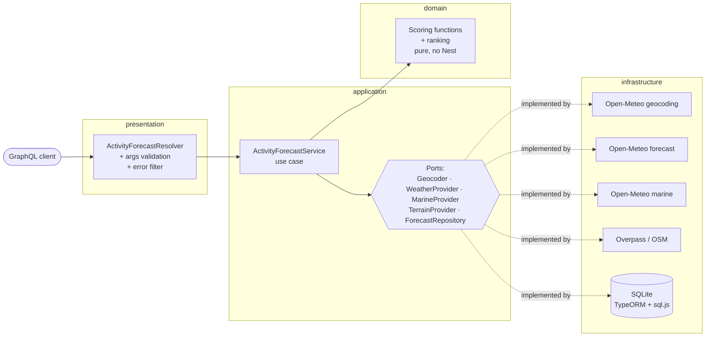

# Activity Forecast

GraphQL API (NestJS + TypeScript) that, for a city or town, ranks the next 7 days for
**skiing**, **surfing**, **outdoor sightseeing** and **indoor sightseeing**.
Weather from [Open-Meteo](https://open-meteo.com) (forecast, marine, geocoding — no API
key), ski areas from OpenStreetMap (Overpass). Data is persisted in SQLite and refreshed
lazily. No front end.

> Decision log with the reasoning behind every choice: **[NOTES.md](NOTES.md)**.

## Quickstart (60 seconds)

Needs Node.js 20+.

```bash
npm install
npm run start:dev
# open http://localhost:3000/graphql  (Apollo Sandbox, example query pre-filled)
```

No `.env` needed; the SQLite file is created at `data/activity-forecast.sqlite`.
All settings are optional and documented in [.env.example](.env.example).

Or with Docker:

```bash
docker compose up --build
# http://localhost:3000/graphql
```

From the command line (needs the server running):

```bash
examples/query.sh                       # Chamonix
examples/query.sh biarritz.graphql madrid.graphql paris-ambiguous.graphql
```

## Example

```graphql
query {
  activityForecast(city: "Chamonix", country: "FR") {
    location { name country latitude longitude timezone }
    dataFreshness { fetchedAt isStale }
    activities { activity bestDay days { date score reason } }
  }
}
```

Response (trimmed; full live responses in [examples/responses/](examples/responses/)):

```jsonc
// Chamonix, FR (live, 2026-10-14T16:20:47.931Z)
{
  "location": {"name":"Chamonix","country":"France","latitude":45.92375,"longitude":6.86933,"timezone":"Europe/Paris"},
  "dataFreshness": {"fetchedAt":"2026-10-14T16:20:47.931Z","isStale":false},
  "activities": [
    {
      "activity": "SKIING", "bestDay": null,
      "days": [
        { "date": "2026-10-14", "score": 0, "reason": "little or no snow, snow depth 0 cm, mild (19°C max)" },
        { "date": "2026-10-15", "score": 0, "reason": "little or no snow, snow depth 0 cm, mild (21°C max)" }
        // …5 more, best-first
      ]
    },
    {
      "activity": "SURFING", "bestDay": null,
      "days": [
        { "date": "2026-10-14", "score": null, "reason": "no coastal data" },
        { "date": "2026-10-15", "score": null, "reason": "no coastal data" }
        // …5 more, best-first
      ]
    },
    {
      "activity": "OUTDOOR_SIGHTSEEING", "bestDay": "2026-10-14",
      "days": [
        { "date": "2026-10-14", "score": 100, "reason": "pleasant 19°C, sunny" },
        { "date": "2026-10-15", "score": 100, "reason": "pleasant 21°C, sunny" }
        // …5 more, best-first
      ]
    },
    {
      "activity": "INDOOR_SIGHTSEEING", "bestDay": "2026-10-18",
      "days": [
        { "date": "2026-10-18", "score": 72, "reason": "always available; mixed weather outside" },
        { "date": "2026-10-17", "score": 48, "reason": "always available, but the weather favours being outdoors" }
        // …5 more, best-first
      ]
    }
  ]
}

// Biarritz, FR: surfing
{
  "activity": "SURFING", "bestDay": "2026-10-20",
  "days": [
    { "date": "2026-10-20", "score": 100, "reason": "waves 1.3 m, period 14 s" },
    { "date": "2026-10-16", "score": 98, "reason": "waves 2.0 m, period 13 s" },
    { "date": "2026-10-15", "score": 96, "reason": "waves 1.7 m, period 12 s" }
    // …4 more, best-first
  ]
}
```

- `score` is an `Int` 0–100, or `null` when the activity can't be assessed
  (`no coastal data`, or the ski-area lookup is temporarily unavailable).
- Each activity's `days` are sorted best-first; `bestDay` is `null` if nothing scores above 0.
- Dates are local to the location's timezone.
- Errors carry `extensions.code`: `CITY_NOT_FOUND`, `UPSTREAM_UNAVAILABLE`, `BAD_REQUEST`
  (e.g. `country` not a 2-letter ISO code).

The full schema is in [schema.gql](schema.gql) (generated from the code).

## Architecture



```
src/
  domain/          entities, value objects, scoring/ (one file per activity), ranking
  application/     ActivityForecastService, ports/ (interfaces + DI tokens), errors, SingleFlight
  infrastructure/  open-meteo/, overpass/, http/, persistence/ (TypeORM entities + repo)
  presentation/    graphql/ (resolver, types, args, error filter, Sandbox example)
  config/          typed config with defaults
```

## Persistence & refresh

| Data | Stored as | Fresh for |
|---|---|---|
| Geocoding (`city|country` → place) | `geocode_cache` | forever |
| Weather + marine forecast | raw JSON in `forecast_snapshot` with `fetchedAt` | `FORECAST_TTL_HOURS` (3) |
| "Ski area within 50 km?" | `ski_terrain` | `TERRAIN_CACHE_DAYS` (90) |

- **Lazy refresh**: a request finds the stored snapshot; if it is older than the TTL it
  refetches, otherwise serves from SQLite.
- **One fetch per location at a time**: concurrent requests share the same in-flight
  promise.
- **Upstream down?** Serve the last stored data with `dataFreshness.isStale: true`.
  Only if nothing is stored do we return `UPSTREAM_UNAVAILABLE`.
- **Scores are computed per request** from the stored raw payloads, so scoring rules can
  change without refetching.
- **No cron**: there's no fixed set of cities to refresh; lazy refresh spends API calls
  only on places people ask about and keeps it a single process (see NOTES D6).

## Scoring (v1 heuristics, tunable)

Simple, commented, pure functions in `src/domain/scoring/`, constants at the top of each
file. Summary in [NOTES.md D9](NOTES.md#d9-scoring-rules-are-v1-heuristics-tunable).

### Scoring caveats
- Skiing uses Open-Meteo snow depth at the **town's** coordinates, not the slopes, so a
  valley town like Chamonix under-reports the snow up high. Resort elevation would fix it.
- The ski-area gate is "any ski area/piste within 50 km", so e.g. **Madrid** passes
  (Sierra de Guadarrama resorts, and an indoor slope) and gets snow-based scores
  (usually near 0 outside winter).
- Surf uses max wave height/period at the nearest marine grid cell; no swell direction,
  tide or spot orientation.
- Indoor sightseeing is purely the inverse of outdoor weather; it doesn't know whether
  the place has museums.
- Public Overpass servers are often overloaded. A first-time lookup waits at most 15 s,
  then skiing is `null` ("try again shortly") while the lookup finishes in the background.

## Assumptions & open questions
1. **Per activity across days** is the primary view; *best activity per day* is derivable
   from the same 28 scores (`bestActivityPerDay`, not yet in the schema). Which does the
   product want? Both?
2. Ambiguous names resolve to the **top geocoding match**; `country` narrows it. Should we
   return candidates instead?
3. "Next 7 days" = today + 6 in the location's timezone; past days are dropped if data is
   stale.
4. `null` = can't assess, `0` = assessed and bad. Is that distinction useful to clients?
5. 3 h TTL matches how often the forecast models update; tune with `FORECAST_TTL_HOURS`.

## What I'd do next
- Tune the heuristics against real feedback; use resort elevation for snow.
- Stale-while-revalidate (serve old data instantly, refresh in the background).
- Expose `bestActivityPerDay`; return geocoding candidates for ambiguous names.
- Postgres + migrations and a shared lock/queue for in-flight fetches when running more
  than one instance; rate limiting; metrics on cache hit rate and upstream latency.
- Self-host or pre-compute the ski-area dataset instead of depending on public Overpass.

## Tests

```bash
npm test            # unit: every scoring function, ranking, service caching/refresh, parsers
npm run test:e2e    # GraphQL query through the whole app; network adapters faked
npm run lint        # ESLint + Prettier (fixes); lint:check / format:check to only check
```

## Repo notes
- [NOTES.md](NOTES.md) — dated decision log.
- [examples/](examples/) — ready queries, `query.sh`, saved live responses.
- [ai-sessions/](ai-sessions/) — AI session transcripts.
